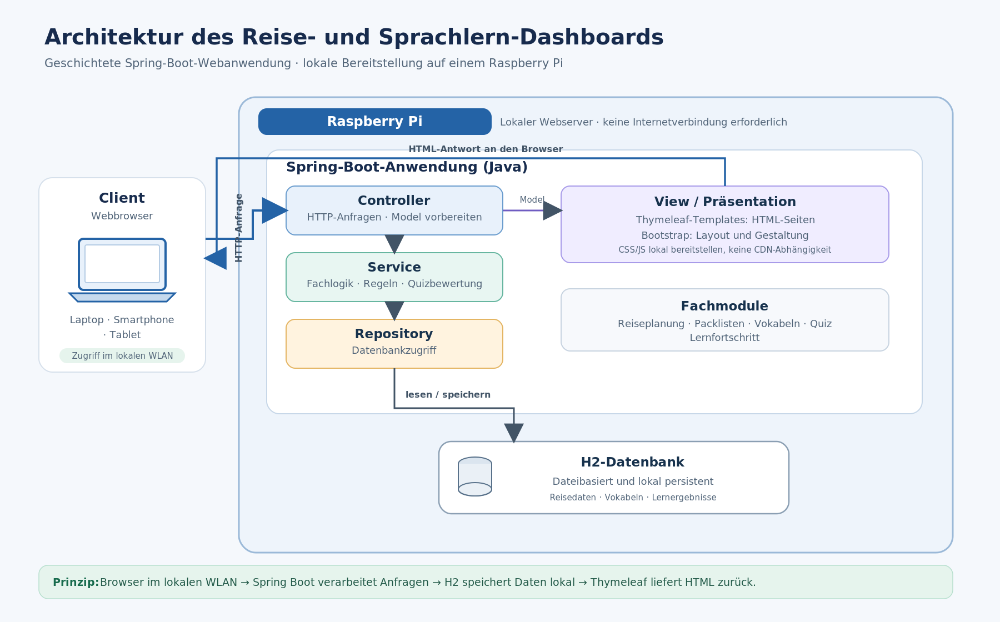

# Grundgerüst

1. Client (Webbrowser)
- Benutzer öffnet Dashboard auf Laptop etc.

2. Webanwendung (Java und Spring Boot)
- Spring Boot verarbeitet Anfragen, führt Anwendungslogik aus und stellt benötigte Daten bereit

3. Frontend (Thymeleaf und Bootstrap)
- Thymeleaf erzeugt HTML-Seiten auf dem Server
- Bootstrap sorgt für die Gestaltung der Benutzeroberfläche

4. Datenbank H2
- H2 speichert die Daten lokal (Reiseziele, Tagespläne, Packlisten, Vokabeln, Lernfortschritt)

# Softwarearchitektur
- MVC (Model-View-Controller)

# Typischer Ablauf
1. Dashboard im Browser öffnen
2. Formular ausfüllen und "Speichern"
3. Browser sendet Eingaben an Spring Boot
4. Controller nimmt die Anfrage entgegen
5. Anwendungslogik verarbeitet und validiert die Eingaben
6. Datenzugriff speichert das Reiseziel in der H2-Datenbank
7. Spring Boot erzeugt die aktualisierte Seite
8. Browser zeigt das gespeicherte Reiseziel an (View)

# Schichtenarchitektur
- Presentation Layer: Controller + Thymeleaf
- Business Logic Layer: Services
- Data Access Layer: Repositories
- Database Layer: H2

# Rolle Raspberry Pi
- lässt die Spring-Boot-Anwendung laufen
- stellt die Webseiten im lokalen Netzwerk bereit
- andere Geräte öffnen das Dashboard über ihren Webbrowser
- die Datenbank liegt lokal auf dem Raspberry Pi
- Betrieb ohne Internetverbindung

# Architekturdiagramm

